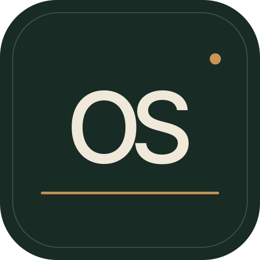

  

<h1 align="center">Oleksandr Shpyrka</h1>

  <strong>Software Developer · Full-Stack Engineering · AI Agents & Automation</strong> 
  Building practical software, reliable integrations, and tools that reduce repetitive work.

  <a href="https://www.linkedin.com/in/oleksandr-shpyrka-09642341b/">LinkedIn</a>
  &nbsp;·&nbsp;
  <a href="https://coursera.org/verify/professional-cert/2HX52WZULD8U">Google AI Professional Certificate</a>
  &nbsp;·&nbsp;
  <a href="#selected-work">Selected work</a>

---

### About

I'm a software developer based in **Wrocław, Poland**, focused on **Python, TypeScript, full-stack product development, API integrations, and AI-assisted automation**.

I worked on commercial software at **SmartExpert (October 2025 – September 2026)**, contributing to interfaces, backend services, automation, integration reliability, and verification. Outside commercial work, I explore AI assistants, developer tooling, and game systems through personal projects.

I use AI coding agents in my workflow, but I treat their output as code to understand, test, and review—not as a substitute for engineering judgment.

**Currently interested in:** software engineering, backend/full-stack development, AI integrations, and automation. Remote opportunities are preferred; Wrocław-based roles are also relevant.

### Technical focus

| Area | Tools and experience |
| --- | --- |
| **Backend & APIs** | Python · FastAPI · REST APIs · SQL · PostgreSQL |
| **Frontend & applications** | TypeScript · React · Node.js (personal projects) |
| **AI engineering** | OpenAI APIs · tool orchestration · structured outputs · retrieval/context workflows · Codex |
| **Engineering practices** | Git · Docker · automated testing · regression checks · integration troubleshooting |
| **Exploring** | C# / .NET · Unity modding · developer-agent workflows |

### Selected work

The source code for the projects below is currently **private**. These pages describe my involvement, engineering decisions, and current limitations without implying that the repositories are public or production services.

| Project | What it demonstrates | Case study |
| --- | --- | --- |
| **AInora** — personal local assistant | AI tools, voice workflows, permissions, memory, scheduled tasks; Node.js/TypeScript | [Explore AInora](projects/ainora.md) |
| **IFZ Coop** — independent co-op prototype | Gameplay requirements, C#/.NET & Unity modding, playtesting, bug reproduction, sync verification | [Explore IFZ Coop](projects/ifz-coop.md) |
| **SuperCodex** — personal developer tooling | Agent workflow design, issue/task orchestration, web/desktop interfaces, Go and TypeScript | [Explore SuperCodex](projects/supercodex.md) |

### Education & learning

**B.Eng. in Computer Science — in progress**, expected 2028 · Wrocławska Akademia Biznesu w Naukach Stosowanych.

**Google AI Professional Certificate (2026)** · 8-course program, including AI for App Building and AI for App Deployment. [Verify credential](https://coursera.org/verify/professional-cert/2HX52WZULD8U).

### Contact

For professional opportunities or collaboration, the easiest way to reach me is via **[LinkedIn](https://www.linkedin.com/in/oleksandr-shpyrka-09642341b/)**.

Personal projects are independent prototypes; references to third-party games or platforms do not imply affiliation or endorsement. Last updated: November 2026.
