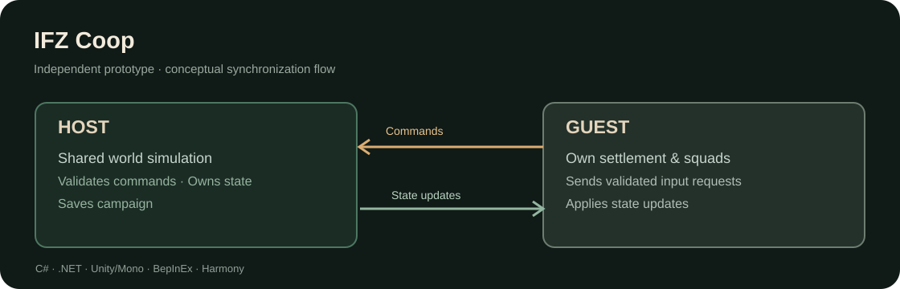

# IFZ Coop — independent multiplayer prototype

[← Back to profile](../README.md)

**Status:** independently developed work-in-progress prototype for *Infection Free Zone*. **Source:** private. Not an official feature of the game; not affiliated with Jutsu Games or the publisher.

## Why this project

I wanted to explore cooperative play without replacing the game's core simulation: two players managing separate settlements within one shared campaign.

## Technical approach explored

- C# / .NET, Unity/Mono, BepInEx, Harmony, and custom network/synchronization components.
- Host-authoritative simulation: guest actions are checked against ownership and game state before being applied.
- Separate settlement resources and state, coordinated game time, and co-op exchanges.
- Save/rejoin flows and debugging of host/guest synchronization problems.

## My contribution

I drove gameplay requirements and playtests, documented reproduction steps, gathered guest logs and screenshots, and verified fixes in the game. I used AI coding tools as part of the development process and distinguish my testing/product contribution from implementation generated with those tools.

## Example engineering problem

During testing, a guest synchronization problem involved a worker whose job assignment could become inconsistent while moving between groups. I gathered reports and logs, narrowed the reproduction conditions, and checked expected host/guest state after the fix, including save, reload, and rejoin in the tested scenario.

## Current limitations

This remains a beta/work-in-progress prototype. The repository contains ongoing changes and validation status varies by build; a screenshot or local test is not a claim that every multiplayer scenario works reliably on two independent PCs.

**Availability:** source is private; selected screenshots and a short demonstration can be shared in a professional discussion where appropriate.
